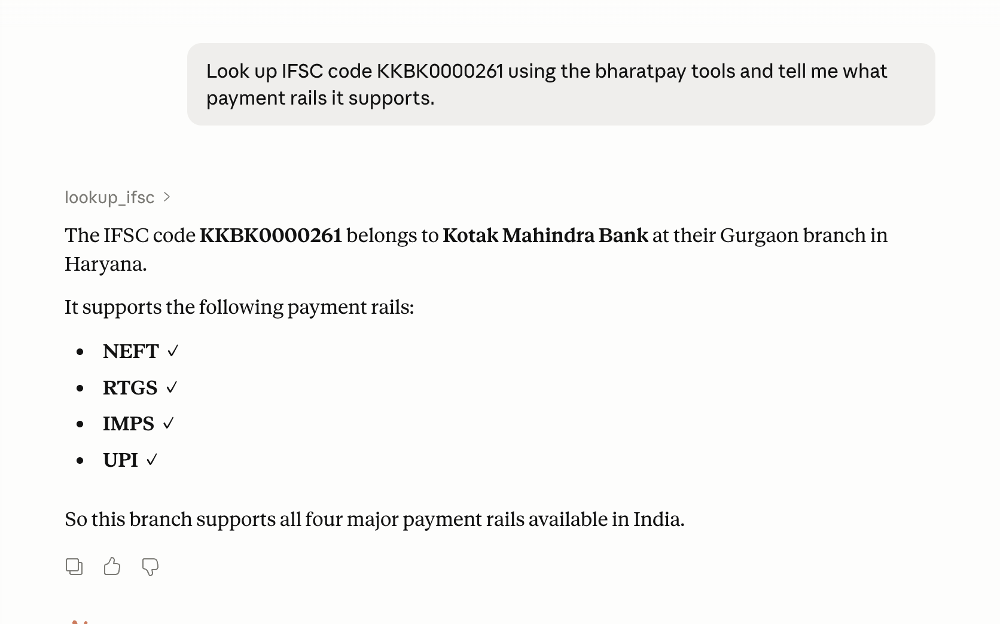

# 🇮🇳 BharatPay MCP

## Workbench backend

The repository now has two adapters over shared Python services: the original
seven-tool MCP server and an optional FastAPI backend with private vendor records,
CSV batch jobs, and NAV ingestion. The original MCP command still works without
MongoDB, accounts, or the API extra. No tools move money.

### Run the complete local backend

```bash
docker compose up --build -d --wait
```

Open http://127.0.0.1:8000 for the responsive dashboard, or
http://127.0.0.1:8000/docs for interactive API documentation. The dashboard covers
sign-in, vendor CRUD, validation, CSV upload/results/reports and NAV history.
Compose starts the API, a separate worker and
MongoDB; MongoDB data lives in the `mongo-data` volume and has no host port.
Stop using `docker compose down`; omit `--volumes` to preserve saved records.
`/health` is liveness; `/ready` also checks the configured database.

1. Use `POST /api/v1/auth/register` with a username (3–40 letters, digits, dots,
   underscores or hyphens) and a password (10–128 characters).
2. Call `/api/v1/auth/login`, copy `access_token`, and enter it through Swagger's
   **Authorize** button. Sessions expire after two hours; logout revokes them.
3. Create a record through `POST /api/v1/vendors`, for example
   `{"name":"Demo","pan":"ABCPE1234F"}`. Use synthetic identifiers.
4. Call `POST /api/v1/vendors/{id}/validate`, then list `/validation-runs` and
   `/stats`. Each user's records and jobs are private to that account.
5. Upload `examples/vendors.csv` to `POST /api/v1/batch-jobs`. Poll the returned
   job id, inspect `/results`, and download `/report.csv`. Invalid rows do not
   stop the other rows. An optional `Idempotency-Key` header deduplicates uploads.
6. Queue `POST /api/v1/ingestions/nav`. The worker ingests public AMFI data;
   inspect `/ingestion-runs` and `/funds/{scheme_code}/nav-history` afterward.

### Routes

All application routes below start with `/api/v1`.

| Group | Routes |
| --- | --- |
| Offline utilities | POST `/validations/pan`, `/validations/gstin`, `/validations/upi`, `/format/inr` |
| Async lookups | GET `/lookups/ifsc/{code}`, `/lookups/pincode/{code}`, `/funds/search?q=...` |
| Accounts | POST `/auth/register`, `/auth/login`, `/auth/logout`; GET `/auth/me` |
| Vendors | POST/GET `/vendors`; GET/PUT/DELETE `/vendors/{id}`; POST `/vendors/{id}/validate` |
| History | GET `/validation-runs`, `/stats` |
| Durable jobs | POST/GET `/batch-jobs`; GET `/batch-jobs/{id}`, `/{id}/results`, `/{id}/report.csv`; POST `/{id}/retry` |
| Public-source ingestion | POST `/ingestions/nav`; GET `/ingestion-runs`, `/funds/{scheme_code}/nav-history` |

Vendor, job, history and ingestion routes require a bearer token. List routes
support `page` and `page_size` (maximum 100). Public-source ingestion history is
shared between accounts; private vendor data is not. Failed private-id lookups
return 404, without revealing another account's record.

Malformed request bodies return 422. Offline validation results use 200 with
`valid: false` for a completed domain check. Lookup routes distinguish invalid
input (422), missing records (404), provider failure (502) and timeout (504).
The API owns a shared async HTTP client. NAV refresh is protected by a lock;
when refresh fails, older cached data is explicitly marked `stale: true`.
NAV dates are source-record dates (ISO); `fetched_at` is download time. NAV
values are decimal strings. INR uses half-up rounding to integer paise.

### Tests and local Python development

```bash
python3 -m venv .venv-api
source .venv-api/bin/activate
python -m pip install -e ".[api,dev]"
python -m pytest tests/ -q
python -m uvicorn bharatpay_mcp.api.app:app --reload
```

Without `MONGO_URL`, pure validation and lookup routes work; saved workflows
explicitly return 503. For the full persistence flow, use Compose, which supplies
`MONGO_URL=mongodb://mongo:27017`. `MONGO_DATABASE` defaults to `bharatpay`.
The offline suite mocks providers and requires no database. To explicitly test
the running API, MongoDB indexes, worker, lease recovery and ETL replay:

```bash
docker compose exec -T api python < scripts/check_backend.py
```

The integration check creates synthetic accounts and removes only its own data;
a uniquely named temporary database is created and dropped for recovery/ETL tests.

### Standalone ETL and optional Airflow

```bash
docker compose exec api python -m bharatpay_mcp.ingest
docker compose --profile airflow up --build -d airflow
```

The optional local Airflow standalone instance is at http://127.0.0.1:8080. Its
authentication details are generated by Airflow in the container; follow its
startup logs/local authentication configuration. The `bharatpay_daily_nav` DAG
runs weekdays at 19:00 UTC with two retries, no catchup, and one active run. It
calls the same ETL used by the CLI and worker. Unpause the DAG in Airflow to enable
scheduled runs; a manual DAG test has been verified. Both the current eight-column
and legacy six-column AMFI formats are supported. The latest AMFI file cannot recreate
historical dates: this project accumulates history from each successful fetch;
Airflow backfill does not magically provide older source data.

### Scope and limits

This is a local portfolio backend. Passwords are scrypt-hashed; only bearer-token
hashes are stored; database expiry is checked independently of MongoDB TTL cleanup.
Auth rate limits and lookup caches are per process. MongoDB is isolated inside
the Compose network without database auth: add deployment secrets, TLS and database
auth before hosting it. CSV uploads are limited to 1 MB and 500 rows. Workers use
five concurrent row checks, a 120-second renewable lease, three automatic attempts,
and stable row ids for restart recovery. Execution is at least once, not exactly
once. Pagination uses bounded offsets and is intended for portfolio-scale data.

Format/checksum checks do not prove identity, registration or account activeness.
Use synthetic data. A small HTML/CSS/JavaScript dashboard is served by FastAPI; the Django exercise
remains later learning work. Taskflow
is the primary full-stack portfolio project. See [architecture and milestones](docs/backend-roadmap.md).


> **An MCP server that gives any AI agent — Claude Desktop, Cursor, Windsurf — instant access to Indian fintech utilities.** IFSC bank lookups, PAN/GSTIN validation with checksums, mutual fund NAVs, UPI VPA identification, pincode lookups, and Indian-style INR formatting. Seven tools. Zero auth. Zero cost. Designed to complement [Razorpay's official MCP server](https://github.com/razorpay/razorpay-mcp-server) — they handle execution, BharatPay handles validation and lookups.

🎥 **Demo coming soon** · 📦 **`pip install bharatpay-mcp`** · 🔗 **[PyPI](https://pypi.org/project/bharatpay-mcp/)**

---

## Why this exists

Razorpay shipped an official MCP server in early 2025 for executing payment operations — creating orders, capturing payments, refunding. It's excellent.

But every Indian fintech project also needs a layer below that: **validation and enrichment**. Is this PAN's format correct? Does this GSTIN's mod-36 checksum verify? What bank does this IFSC code belong to? What's the PSP behind `user@oksbi`? What's today's NAV for Parag Parikh Flexi Cap?

Currently, an AI agent has to either hallucinate these answers or call seven different APIs with seven different auth schemes. **BharatPay collapses all of it into a single MCP server an agent can install in 30 seconds.**

Position-wise: BharatPay sits *next to* Razorpay's MCP, not in competition with it. They handle transactions; we handle validation. Use both together for a complete Indian-fintech AI stack.

--- 

## Demo

Claude Desktop autonomously calling `lookup_ifsc` for an Indian bank lookup:

[](https://pypi.org/project/bharatpay-mcp/)
[](https://pepy.tech/project/bharatpay-mcp)




---
## What's in the box

| Tool | Input | What it returns |
|---|---|---|
| `lookup_ifsc` | `KKBK0000261` | Bank, branch, address, MICR/SWIFT, supported rails (NEFT/RTGS/IMPS/UPI). Source: [Razorpay's open IFSC API](https://github.com/razorpay/ifsc). |
| `validate_pan` | `AABCT3518Q` | Format check, entity type (Individual/Company/HUF/Trust/...) decoded from the 4th character. |
| `validate_gstin` | `29AABCT1332L1ZS` | Format + mod-36 checksum verification, embedded state and PAN extraction. |
| `lookup_pincode` | `302001` | District, state, all post offices. Source: India Post API. |
| `get_mutual_fund_nav` | `parag parikh flexi cap` *or* `122639` | Latest NAV from AMFI's daily file. Fuzzy name search or exact code lookup. Cached for 6h. |
| `validate_upi_vpa` | `angelina@oksbi` | PSP identification (Google Pay/PhonePe/Paytm/...) and underlying bank from the handle suffix. |
| `format_inr` | `100000` *or* `29500` (paise mode) | `₹1,00,000` (Indian comma style) + word form (`1 Lakh`, `1.5 Crore`, etc.). |

## Architecture

```
┌─────────────────────┐                    ┌──────────────────────┐
│   AI Agent          │   MCP / stdio      │   BharatPay MCP      │
│   (Claude / Cursor) │ ─────────────────> │   (this server)      │
└─────────────────────┘                    └──────────┬───────────┘
                                                      │
                          ┌───────────────────────────┼───────────────────────────┐
                          │                           │                           │
                   ┌──────▼──────┐         ┌──────────▼─────────┐        ┌────────▼────────┐
                   │  Pure-logic │         │   Live HTTP APIs   │        │   Cached file   │
                   │  validators │         │ (no auth, no cost) │        │   (refreshed 6h)│
                   ├─────────────┤         ├────────────────────┤        ├─────────────────┤
                   │ PAN         │         │ ifsc.razorpay.com  │        │ AMFI NAVAll.txt │
                   │ GSTIN+mod36 │         │ postalpincode.in   │        │ (~6 MB, ~30K    │
                   │ UPI VPA     │         │                    │        │  schemes)       │
                   │ INR format  │         │                    │        │                 │
                   └─────────────┘         └────────────────────┘        └─────────────────┘
```

**Design notes worth calling out:**

1. **Validators are pure functions.** PAN, GSTIN, UPI, and INR run entirely offline — zero network, zero failures from API outages. The mod-36 GSTIN checksum is implemented from the GSTN spec (verified self-consistent: see `tests/test_validators.py::test_gstin_checksum_self_consistent`).
2. **Network tools are async.** IFSC and pincode lookups use `httpx.AsyncClient` so the MCP server can handle parallel tool calls without blocking.
3. **AMFI data is cached, not re-fetched per call.** A single 6 MB file covers all ~30,000 Indian mutual fund schemes; refreshing it on every NAV query would be wasteful and slow. Cache TTL: 6 hours.
4. **Tool descriptions are LLM-tuned.** Each tool's docstring is written for the *model* to read — explicit input formats, examples, and what it returns. This is what determines whether an agent successfully picks the right tool.
5. **No data leaves your machine for offline tools.** PAN/GSTIN/UPI/INR validation never touches the network. Useful for compliance-sensitive contexts.

## Install

### Option 1: pip (recommended)

```bash
pip install bharatpay-mcp
```

Then add to `~/Library/Application Support/Claude/claude_desktop_config.json` (Mac) or the Windows equivalent:

```json
{
  "mcpServers": {
    "bharatpay": {
      "command": "python",
      "args": ["-m", "bharatpay_mcp"]
    }
  }
}
```

Restart Claude Desktop. Look for the 🔌 icon — `bharatpay` should be listed.

### Option 2: From source

```bash
git clone https://github.com/angelina10504/bharatpay-mcp
cd bharatpay-mcp
pip install -e .
```

### For Cursor

Add to `.cursor/mcp.json` in your project:

```json
{
  "mcpServers": {
    "bharatpay": {
      "command": "python",
      "args": ["-m", "bharatpay_mcp"]
    }
  }
}
```

## Try it

Once connected, try these prompts in Claude Desktop:

> *"Look up IFSC code KKBK0000261 and tell me what payment rails it supports."*

> *"Is `29AAGCB7407Q1ZN` a valid GSTIN? If so, what state is the entity registered in?"*

> *"What's today's NAV for Parag Parikh Flexi Cap regular growth?"*

> *"My friend's UPI ID is `priya@oksbi` — which app does she use?"*

> *"Format ₹12,00,000 in Indian style and tell me what it would be in paise."*

The agent will autonomously pick the right tool. You'll see the tool call and its structured JSON response inline.

## Tests

```bash
pip install -e ".[dev]"
pytest tests/ -v
```

The offline suite covers validators, REST contracts, mocked provider failures, cache concurrency, CSV limits, and password hashing. Explicit MongoDB/worker checks live in `scripts/check_backend.py`.

## What's next (V2)

- **`validate_aadhaar(number)`** — Verhoeff checksum (offline, no UIDAI API needed)
- **`get_holiday_calendar()`** — RBI bank holidays (settlement-day awareness)
- **`stock_quote(symbol)`** — NSE/BSE live quotes for `RELIANCE.NS`-style tickers
- **`tax_slab_calculator(income, regime)`** — Old vs new regime estimation
- **Bundle as `npx @bharatpay/mcp`** for zero-install distribution

Open an issue on GitHub if you want any of these prioritized.

## A note on "AI-first India"

When Razorpay [launched their MCP server](https://x.com/shashank_kr/status/1916426439785848867), they framed it as "designed for an AI-first world." That framing is right — but transactions are only half the picture. Half the engineering effort in any Indian fintech goes into **validation, enrichment, and lookups** that an AI agent can't reliably hallucinate. That's the gap BharatPay fills.

If you're building AI tools for Indian fintech and you find a utility missing, open an issue or send a PR.

## License

MIT — see [LICENSE](./LICENSE). All upstream APIs (Razorpay IFSC, India Post, AMFI) are themselves free and publicly available under their respective terms.

---

Built by Angelina Gupta · April 2026 
