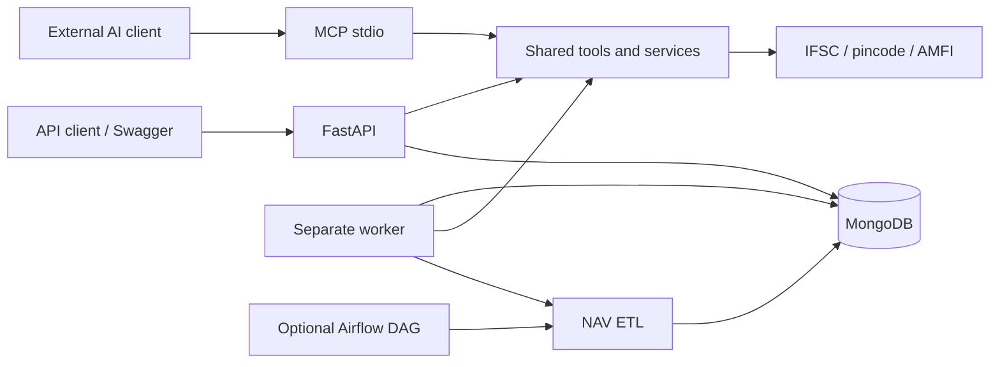

# Backend architecture and milestone status

Implemented: offline REST adapter; reliable async lookups; NAV cache; MongoDB
indexes and private vendor CRUD; revocable sessions; saved validation history;
pagination and aggregation; CSV uploads and row reports; renewable worker leases;
idempotent NAV snapshots with quality/rejection summaries; CLI and optional
Airflow DAG; Docker Compose and offline CI tests.

Implemented small responsive dashboard: accounts, vendors, quick checks, CSV
upload and progress, row reports, and NAV freshness/history. The frontend consumes
the documented API without duplicating domain rules. Django and a small HTML
scraping exercise remain separate learning additions. A larger React frontend is
optional; Taskflow remains the main full-stack portfolio demonstration.

## Persistence and recovery

Collections: users, sessions, vendors, validation_runs, batch_jobs, batch_rows,
nav_snapshots, ingestion_runs. Every private read or mutation includes owner_id.
Sessions expire after two hours, are revocable, and store hashes rather than raw
tokens. Private records retain supplied synthetic values for validation history.

Jobs are atomically claimed. A 25-second heartbeat extends a 120-second lease.
A restarted worker claims expired jobs and retries up to three times. Stable
job/row ids avoid duplicate CSV results. NAV upserts use a unique scheme/date
index, so repeated ingestion does not add duplicate observations. Results can be
partially written before failure and replay safely. Invalid rows are reported;
provider-error rows may be retried. All job execution is at least once.

NAV ingestion records accepted counts, rejected-row reasons (first 100), source,
start/finish timestamps and failure state. A replacement job marks its earlier
interrupted ingestion attempt. Snapshot dates are independent of fetch timestamps.

## Validation evidence

`pytest tests/` is offline. `scripts/check_backend.py` explicitly exercises the
real running API, MongoDB and worker, including account isolation and job recovery,
with a separate temporary database for ETL replay. Live providers can be unavailable;
mocked tests establish error contracts without treating upstream uptime as correctness.

## Interview checkpoints (after implementation)

Trace schema -> route -> service -> repository. Explain domain failure versus HTTP
failure, async I/O versus CPU work, bounded concurrency, cache stampedes, compound
indexes, ownership filtering, leased jobs, at-least-once execution, idempotency,
ETL quality checks, and source-date versus fetch-time semantics. Use actual measured
query plans before claiming an index improves a particular workload.
