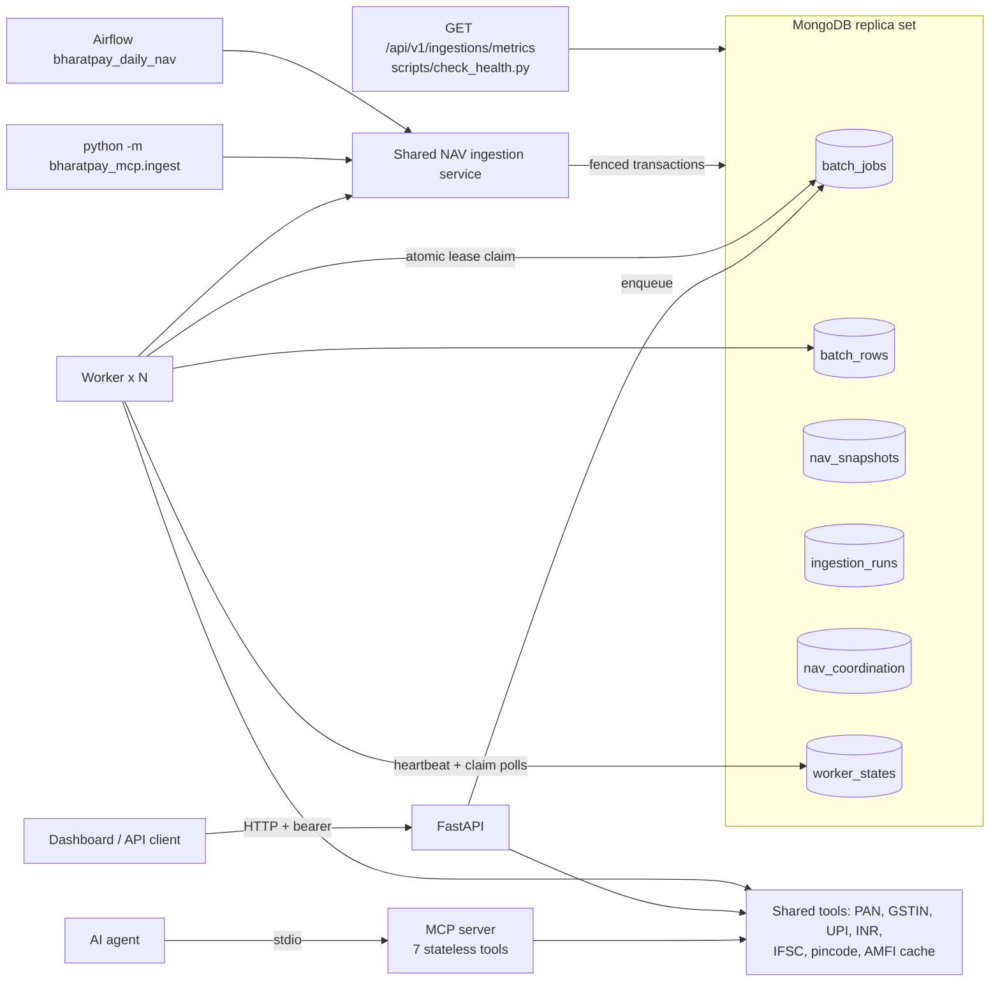

# Operating BharatPay Workbench

Operator guide for the FastAPI backend, worker, NAV ETL and optional Airflow
schedule. Design rationale for NAV fencing is in [nav-reliability.md](nav-reliability.md);
recorded test results are in [nav-validation.md](nav-validation.md).

## Architecture



**MCP vs FastAPI.** The MCP server (`python -m bharatpay_mcp`) is the published
PyPI product: seven offline-first tools over stdio, no database, no accounts. The
FastAPI app is an optional adapter over the same tool functions that adds
accounts, private vendor records, CSV batch jobs and NAV history. Installing
`bharatpay-mcp` without the `api` extra never imports FastAPI or PyMongo.

**MongoDB topology.** All workbench features run on standalone MongoDB **except NAV
ingestion**, which requires a replica set because every batch is fenced inside a
multi-document transaction. On standalone, ingestion fails closed with
`error_category=topology` before downloading anything. A single-node replica set
(`compose.nav-replica.yaml`) is enough for transactions but gives no high availability.

## Lifecycles

**CSV job.** `POST /batch-jobs` parses at most 500 rows / 1 MB and returns **202**
with a queued job (an `Idempotency-Key` header returns the same job for the same
content, 409 for different content). A worker atomically claims it with a
120-second lease and a fresh lease token, validates rows five at a time, renews
the lease every 25 seconds, and writes one result per row under a stable id
(`<job>:<row>`), so retries never duplicate rows. Partial row failures end as
`completed_with_errors`; `POST /{id}/retry` requeues failed or partially failed jobs.
Expired leases are reclaimed (counted in `lease_reclaims`); after three attempts the
job fails with `error_category=lease_expired`. Execution is **at least once**:
idempotent row ids make repeats harmless, they do not make them impossible.

**NAV ingestion** (same code for worker, CLI and Airflow): acquire the global
`amfi_nav` lease (busy → `coordination_busy`, run marked `skipped`); stream the AMFI
file with a byte limit, or read `NAV_SOURCE_FILE`/`--fixture`; record SHA-256 and
size; parse; apply quality rules; then upsert in batches of 1,000, each batch in a
transaction that first rewrites the lease document. A newer owner therefore makes
any older batch abort. Each batch is atomic; the whole file is not.

**Airflow.** `bharatpay_daily_nav` has one task, runs weekdays 19:00 UTC, no
catchup, one active run, two retries five minutes apart. Permanent errors
(`quality`, `parse`, `topology`, size, configuration) raise `AirflowFailException`
and skip retries; transient ones (`source_*` network errors, `database`,
`coordination_busy`, `lease_lost`) propagate so Airflow retries. A single task is
deliberate: the steps share one lease and one in-memory artifact, so splitting
them would need intermediate storage and cross-task lease hand-off for no gain.

## Monitoring

`GET /api/v1/ingestions/metrics` (bearer session) and `scripts/check_health.py`
(direct database read, no session) return the same document. It is read-only and
never calls AMFI. The `health` block classifies each component:

| State | Meaning |
| --- | --- |
| `healthy` | Recorded evidence shows it working within thresholds |
| `degraded` | Working, but a threshold or warning needs attention |
| `failed` | Recorded evidence of failure, or required evidence is missing |
| `not_configured` | Optional component with no record, and not declared expected |
| `never_executed` | Expected, but nothing has run yet (e.g. a fresh deployment) |

| Component | Healthy when | Answers |
| --- | --- | --- |
| `database` | Replica set with sessions (transaction-capable) | Is MongoDB connected and transaction-capable? |
| `worker` | ≥1 heartbeat within 30 s **and** ≥1 worker polled for jobs within 60 s or is processing one | Is the worker running *and processing*? A live process whose claim loop has stalled is `degraded`. |
| `nav_ingestion` | Latest success within `HEALTH_MAX_SUCCESS_AGE_HOURS`, no failures since | When did ingestion last succeed? |
| `airflow_schedule` | Same rule, Airflow-triggered runs only | Has the scheduled run failed? |
| `job_queue` | Oldest queued job waited ≤ `HEALTH_MAX_QUEUE_WAIT_SECONDS` (measured from its last state change) | Are jobs waiting unusually long? |
| `leases` | No expired running lease, no unfinished job reclaimed ≥2 times, no lease-expiry failures in 24 h | Are leases repeatedly expiring? |

The overall `status` is the most severe component state. Accepted/rejected counts,
inserted (`upserted_count`) / matched / modified documents and `duration_seconds`
are in `last_completed`, `latest_attempt`, per-trigger `by_trigger.{airflow,cli,worker}`
and cumulative `run_totals` (definitions: [nav-reliability.md](nav-reliability.md#monitoring-endpoints-and-metric-definitions)).

| Threshold variable | Default | Reason |
| --- | --- | --- |
| `HEALTH_MAX_CONSECUTIVE_FAILURES` | 3 | One scheduled run = first attempt + two retries |
| `HEALTH_MAX_SUCCESS_AGE_HOURS` | 96 | Friday→Monday is 72 h, plus one market holiday |
| `HEALTH_MAX_QUEUE_WAIT_SECONDS` | 300 | Idle workers poll every 2 s |
| `HEALTH_EXPECT_AIRFLOW` | unset | Set to `1` where the DAG is deployed, so silence is `never_executed`, not `not_configured` |

### Scheduled alert check

```bash
MONGO_URL='mongodb://…/?replicaSet=…' python scripts/check_health.py            # alert on degraded or worse
MONGO_URL=… python scripts/check_health.py --fail-on failed --json              # page only on failures
```

Exit 0 = within thresholds, 1 = threshold exceeded (one line per component says
why), 2 = database unreachable. Run it from cron or any scheduler; no alerting
service is integrated. In Compose: `docker compose -p <project> -f … exec -T api python scripts/check_health.py`.
`never_executed` does not trip `--fail-on degraded`, so a fresh deployment stays quiet until the first run.

Container healthchecks: `api` probes `/ready` (database ping); `worker` is healthy
only while its claim loop touched `/tmp/worker.alive` within 300 s, so a hung loop
inside a live process turns the container unhealthy.

## Running the isolated stack

Always use a **new project name**, free ports and no `-v` on `down`:

```bash
export COMPOSE_PROJECT_NAME=bharatpay-nav-demo API_PORT=8011 AIRFLOW_PORT=8081
docker compose -f compose.yaml -f compose.nav-replica.yaml up --build -d --wait
docker compose -f compose.yaml -f compose.nav-replica.yaml ps          # api/worker/mongo healthy, mongo-init exited 0
docker compose -f compose.yaml -f compose.nav-replica.yaml --profile airflow up --build -d airflow
docker compose -f compose.yaml -f compose.nav-replica.yaml --profile airflow down   # keeps volumes
```

For a fully synthetic test stack (every NAV trigger reads the fixture, never AMFI),
add `-f compose.fixture.yaml`, then:

```bash
F="-f compose.yaml -f compose.nav-replica.yaml -f compose.fixture.yaml"
docker compose $F exec -T -e NAV_SOURCE_FILE= -e CHECK_WORKER_NAV=1 api python scripts/check_backend.py
docker compose $F --profile airflow run --rm --no-deps airflow python /opt/project/scripts/check_dag.py
docker compose $F --profile airflow run --rm --no-deps airflow bash -c "airflow db migrate && airflow dags test bharatpay_daily_nav"
docker compose $F exec -T -e HEALTH_EXPECT_AIRFLOW=1 api python scripts/check_health.py
```

`NAV_SOURCE_FILE=` is blanked for `check_backend.py` because its fault scenarios
supply their own mocked sources, which the override would replace.

Without Docker, `python scripts/run_isolated_checks.py` (needs `mongod` on PATH)
starts a temporary replica set, the API and two workers and runs everything except Airflow.

## Tests

| Command | Needs | Covers |
| --- | --- | --- |
| `python -m pytest tests/ -q` | nothing (offline) | validators, API contracts, health classification, DAG contract (static), source/quality rules |
| `python scripts/run_isolated_checks.py` | `mongod` | real Mongo: 11 NAV fault scenarios, HTTP/worker flow with 2 workers, worker-triggered NAV, CLI replay, standalone refusal, alert exit code |
| `NAV_TEST_MONGO_URL=… python -m pytest integration/ -q` | a **test** replica set | the 11 NAV scenarios as pytest |
| `scripts/check_dag.py` in the Airflow image | Airflow | real DAG import, schedule/retry contract, error→retry mapping |

## Troubleshooting

| Symptom | Likely cause | Action |
| --- | --- | --- |
| Runs fail with `topology` | Standalone MongoDB | Use the replica-set override; see migration below |
| `mongo-init` exits non-zero | Replica set did not elect a primary within 30 s | `logs mongo-init mongo`; rerun `up` (initiation is idempotent) |
| Worker logs "Database unavailable at startup; retrying" | Mongo not reachable yet | Waits with backoff up to 30 s; check `mongo` health if it persists |
| Worker container restarting repeatedly | Before this change only the worker restarted automatically, so after a Docker restart it looped against a stopped `mongo` | All long-running services now use `restart: unless-stopped`; recreate the project's containers with `up -d` |
| `worker` health `degraded`: heartbeat but no polling | Claim loop stuck in a long job or provider call | Check worker logs; jobs are reclaimed after the 120 s lease expires |
| Runs `skipped` with `coordination_busy` | Another trigger holds the NAV lease | Expected under overlap; worker jobs defer without consuming attempts |
| Run stuck `running` | Writer crashed or lost the DB before saving status | A live worker reconciles it once the lease expires; or the next ingestion does |
| `airflow_schedule` `not_configured` | No Airflow-triggered run recorded | Set `HEALTH_EXPECT_AIRFLOW=1` where Airflow is deployed |

## Data migration limits

`compose.nav-replica.yaml` mounts a **new** `nav-rs-data` volume. It starts empty:
users, vendors, jobs and NAV history from the original standalone `mongo-data`
volume are **not** copied, and that volume is never modified or deleted. Moving
data requires a separately approved procedure: stop all writers, `mongodump` from
the standalone, `mongorestore` into the replica set, verify counts and unique
indexes, then switch every client (API, worker, CLI, Airflow) to the replica-set
URI at once. Do not run old unfenced ingestion code against either database
during the switch. AMFI only publishes the latest NAVs, so lost history cannot be
re-downloaded; only retained raw files (`NAV_RAW_DIR`) can be replayed.

## Security

| Area | Implemented | Local-development default | Required before public deployment |
| --- | --- | --- | --- |
| Passwords / sessions | scrypt (n=16384) with per-user salt; opaque tokens stored as SHA-256; 2 h expiry checked independently of TTL; logout revokes | — | Keep; add password reset and account lockout policy |
| Authorization | Every private read/write filters on `owner_id`; foreign ids return 404 | Open self-registration | Restrict registration; NAV queueing, ingestion history and metrics are visible to **any** signed-in user: put them behind an operator role |
| Rate limiting | 15 auth attempts/min per client IP | In-process, per replica | Shared limiter at a proxy; `request.client.host` is the proxy's IP behind one |
| MongoDB | No host port; only reachable on the Compose network | **No authentication, no TLS** | SCRAM users with least privilege per service, TLS, multi-member replica set, backups |
| Network exposure | API and Airflow published on `127.0.0.1` only | Plain HTTP; `/docs` public | TLS terminating proxy; consider disabling `/docs` |
| Containers | API/worker run as non-root `appuser`; Airflow as `airflow`; `init: true` | No CPU/memory limits | Set resource limits; read-only root filesystem where practical |
| Secrets | None in the repository or images; `.env*` excluded from build context | Airflow standalone generates its admin password at startup | Inject secrets from a secret store; never bake into images |
| Logging | Ingestion diagnostics are fixed strings (no source bodies, URLs or exception text); worker logs job/run ids only | Uvicorn access log records paths, which contain opaque record ids | Ship logs centrally; review retention |
| Dependencies | Major-version ranges; Airflow image pinned to 3.3.2 | `python:3.11-slim`, `mongo:7.0` tags float | Lock file and digest-pinned base images, plus dependency scanning |
| CSV reports | Formula-prefixed cells are escaped | — | — |
